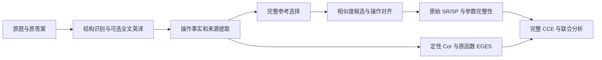

# ClearEval 当前现状与待解决问题

日期：2026-10-12。用途：保存研究现场，供查找方法、讨论技术方案和后续设计验证。

## 1. 目标与当前判断

目标是在保留原参数完整性、Correctness 和 EGES 的前提下接入 BioProBench
原始 SR/SP，完成受控验证、步骤与提取核查、评价稳定性、合理替代路线及
CCE 联合结果分析。原始比例、MPNet、0.7 阈值和公式继续保留；新匹配方法
先作为辅助诊断，不能悄悄替换原 SR 或完整性分数。

现在能运行并得到许多数值，但“能够返回分数”和“分数忠实反映操作覆盖”
之间仍有缺口。最近的主要堵点是操作表示、候选召回和实例对齐的衔接，
以及 Cor 职责/证据要求尚未完成独立因素验证。

当前流程可分为：

有效 JSON 只说明输出结构可读；来源定位只说明能找到所引用文本；两者都不能
代替操作匹配或科学判定。既有分解记录实际上已经保存了大量有用信息，应优先复用。

## 2. 可以交给其他研究者的具体问题

| 问题 | 真实现象与数字 | 已定位/排除什么 | 尚需解决的能力 |
|---|---|---|---|
| 语言及措辞敏感 | C04/C07 中文基线 SR 均为 0；已有英文基线为 1/3、4/7。C07 仅改编号后重译，SR 从 4/7 到 0 | 本批 8/8 回复正常且 JSON 可解析；关键相似度因译文措辞从约 .704 到 .692，跨过 .7。该批未切换参考 | 保真翻译与同义表达下的语义稳健性；不能只靠有效 JSON |
| 标题被当操作 | C04 解析为 39 条，已有模型记录为 36 条；对接后排除三个标题，SP 从 12/39 到 12/36，SR 保持 1/3 | 这是分母对象错误；不是新增覆盖。简单标题规则在六个定向挑战中误删四个操作父行 | 分清章节、父级操作、子操作和操作实例，保留无显式数值的操作 |
| 删除必要操作后无响应 | C04 删除后段操作，原 SR 仍为 3/9；仅限制后段，辅助命中率仍为 3/9 | 跨阶段误配被挡后，纯甲醇处理仍匹配到混合溶剂句，约 .7122；同一句又服务另一参考 | 对象角色、阶段与执行实例的联合判断；同阶段并不代表同操作 |
| 真正相关操作未进入候选 | C07 中两个按 THF 与浓度身份定位的句子余弦只有 .5864、.5879，排名均第六；四条参考反而共用一个高分句 | 句级一对一使基线辅助值 4/7→1/7，却没找回被阈值排除的操作；top-5 也漏掉这两条身份候选 | 候选召回与最终覆盖判断分开；利用已提取动作/对象/实例事实找候选 |
| 操作已经分解，但下游未利用 | C07 原始模型返回已有 O10–O14 五个不同操作和各自来源。8 份答案中 7 份有可读取转换，共 169 条来源记录 | 缺陷不能统称为“模型不会分解”；当前句向量 SR 并未充分使用已有操作身份 | 把旧分解接入实际候选、实例计数和对齐；来源绑定仍需准确性核查 |
| 时间关系不能合成一种区间 | 同阶段先 48 h、后累计 72 h，正确总量 158 h；遗漏累计为 134 h，重复相加为 206 h。另例是 20/32 h 执行分支 | 连续范围、累计替换与可选分支是不同语义。来源链已有原句与原值；诊断曾误把中间值读成原始值，已纠正 | 先判归属与关系，再调用原函数；保留分支而非任意平均 |
| Cor 修订效果未知 | 旧待运行设计五对提示、十份请求，真实调用 0 | 两条件同时改职责、缺项要求和标签说明，属于处理混杂；未来完整率上升也不能归因于单项修改 | 固定共同信息，分别验证职责和逐判项证据要求，并核查评分理由 |

上表中的“身份对应”只定位原文报告的对象与浓度，不代表参数、重复次数或
整条路线在科学上都正确。四次标题误删来自定向构造挑战，不是自然错误率。

## 3. 哪些改进有实测支持

**编号与交叉引用规范化：输入层已获支持。** 初版 7/8，通过修复“与5.1可同管共孵育”
这类交叉引用后，8/8 原文/改编号对产生相同拟翻译输入，19/19 内容改变仍被保留。
其中两对沿用此前冻结的编号变体，六对为本轮在真实答案上构造的格式变体。
没有在该新输入上重新运行翻译，因而还不能声称最终分数或随机重复更稳定。

**已有分解复用：两份基线已实际对接。** C04 的 36 条、C07 的 19 条记录已通过
原文编号和真实翻译单元映射连接到现有译文，重新解析全文并按原公式计算了
辅助结果。C04 修正三个标题误计，C07 数量与分值不变。169 条可定位记录不等于
169 条专家认可的正确操作。

**阶段限制和句级容量：单独使用不足。** C04 再加阶段内一对一句级匹配，基线
和删除仍同时为 2/9，删除响应未恢复。C07 的下降也未恢复正确候选。合并后的
一个句子可能真实包含两个操作，因此句级容量 1 不能永久作为实例定义。

**时间解释：旧案例的来源与算术支持当前处理。** 复核覆盖四个案例、五个分支
结果，没有新增时间提取或专家标签。保留初次诊断读错来源层级的记录。

## 4. 论文实验还缺什么

| 实验内容 | 已具备 | 仍不能成立的结论/所缺证据 |
|---|---|---|
| SR/SP 接入与参考 | 有真实来源、逐答案值、完整参考选择记录和配对回放 | 语义匹配准确性尚未验证；扩大参考池不能自动修复实例错配 |
| 受控验证 | 编号、合并、删除等真实全文变体与失败定位 | 删除响应和等义不变性仍有有效反例；需冻结修订后再做完整管线对照 |
| 合理替代路线 | 已有部分来源与开发配对 | 需要完整来源及适用条件支持，不应把不同表达或不同版本自动当作科学等价 |
| 局部提取与步骤核查 | 已有操作、标签、时间来源链和自动修复；两份操作清单对接成功 | 新增专家回传仍为零；一位专家 5 开发＋15 留出计划不变，共享步骤/提取核查 |
| 稳定性 | 保存历史重复与确定性回放；明确了语言/措辞引起的漂移 | 覆盖率改善和固定输出零极差不等于新模型重复更稳定；缺冻结版本下真实重复及第二评价器家族确认 |
| CCE 联合、Pareto 与重采样 | 已有共同任务集、条件场景和重采样/小样本精确枚举结果 | 输入解释、阈值及分支会影响结论；重采样不能修正系统性错配，也不增加独立任务数 |
| 湿实验外部效度 | 保留需求和待定状态 | 没有新增湿实验数据，不能宣称实验成功率或真实可执行性已验证 |

没有某项外部数据时，其他自动工作可继续；对应结论保持待定。完整参考建设与
专家 5＋15 核查分别记账。当前材料已用于开发，不能再视为新的独立留出。

## 5. 寻找解决办法时可聚焦的技术问题

1. **Procedure/event alignment with grounded operation instances**：如何把两个
   文本中的真实操作实例对齐，同时允许一句多操作、重复操作和不同粒度？
2. **Candidate recall versus semantic entailment/coverage**：如何先召回正确对象
   和动作，再判定覆盖，避免固定余弦阈值或 top-k 提前丢掉真正相关条目？
3. **Representation and translation invariance**：如何在参数、否定、次数和引用
   不丢失的前提下，降低格式与忠实改写对评价的影响？
4. **Temporal scope, cumulative duration, and alternative branches**：怎样用有来源
   的局部关系表示区分累计、重复、并行、范围和可选执行，而无需构建整篇可执行实验图？
5. **Criterion-specific LLM judging with factorial diagnosis**：怎样让定性 Cor
   根据各判项所需证据打分，并把职责调整、缺项要求和共同知识的作用分开验证？

这是依据当前现象提出的检索方向，不是已有方法已经解决本任务的断言。候选方法
至少应在以下四类对照中说明效果：等义变化保持、真实缺失响应、正确候选召回、
错误实例不被重复充当覆盖。应同时记录修复旧错误后引入的新错误。

## 6. 直接证据入口

- [改进措施实际验证](workspace/reports/cleareval_20261012/intervention_validation_01/REPORT_zh.md)
- [八次 Qwen 全文翻译及逐例排查](workspace/reports/cleareval_20261012/english_fulltext_pilot/qwen_translation_pending/RESULTS_zh.md)
- [固定矩阵消融](workspace/reports/cleareval_20261012/intervention_validation_01/fixed_matrix_ablations.json)
- [已有操作到译文的实际对接](workspace/reports/cleareval_20261012/intervention_validation_01/operation_bridge_results.json)
- [候选召回的逐条证据](workspace/reports/cleareval_20261012/intervention_validation_01/operation_identity_evidence.json)
- [此前按细节组织的技术调研](workspace/reports/cleareval_20261012/technical_modules_review/CASES_zh.md)
- [修订后的完整实验计划](workspace/refine-logs/EXPERIMENT_PLAN.md)

本次整理没有新增模型调用、语义向量或专家记录。全包计次仍为 446/446；
数据和程序检查通过不代表上述未解决的科学问题已经通过。
