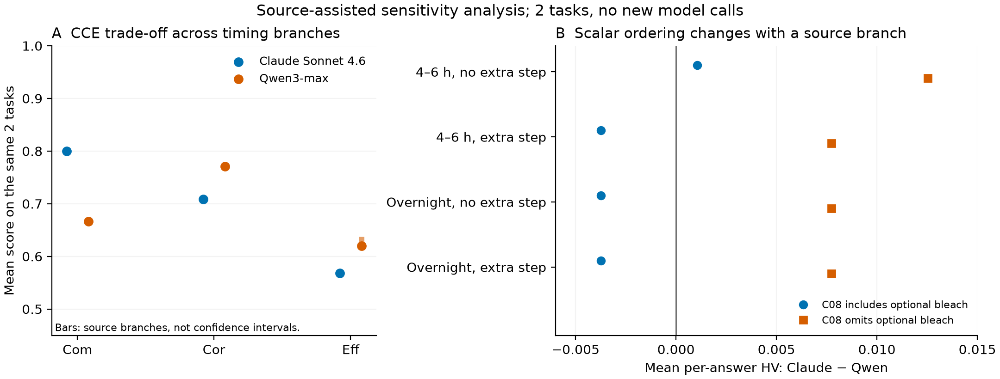

# ClearEval：剩余缺分的来源分解、条件评分与联合分析

本轮继续处理已有的 24 份受控返回与 8 份原确认返回，没有新增模型请求。通用中文方法标题修复恢复了 R3C04 的方法分和透明度分；随后，依据原答案补充语义账本，使 8 份答案的完整单值 CCE 从 **2/8 增至 5/8**，另 **2 份**得到完整条件分支结果。24 份受控结果完全复用，仍为 24/24 完整。

这里的“5/8”包含当前助手的来源辅助分解和明确的取值约定，不能写成全自动评价准确率，也不是新的前瞻确认或专家结果。部分单值对应原文允许的一条已声明路线，其他路线另列。8 份原确认正文已经被用于问题分析，不能再充当未接触的确认集。当前自动候选本身仍是 2/8 完整。

主要产物：[逐答案分数](semantic_04/per_answer.csv)、[全部来源分支](semantic_04/conditional_results.csv)、[语义及取值账本](source_annotations_v3.json)、[实际命令](commands.md)、[联合结果](joint_with_optional_bleach/summary.json)。原 SR/SP、五项直接分数和 CCE/EGES 数值公式保留。

**本轮实验的目标、安排与结果**

| 实验 | 要回答的问题 | 实际安排 | 实际结果与论文含义 |
|---|---|---|---|
| 中文方法标题修复 | 为什么明确写出方法仍丢分？ | 同一规则回放全部 32 返回；保护否定、候选及“或”连接的备选方法 | 仅 R3C04 恢复 s_method=2.375、s_trans=2.814647；72 项检查通过。这是解析规则的局部修复。 |
| 来源辅助标签与时间分解 | 缺值是否真的源于原文没有信息？ | 5 份答案逐单元阅读，记录 9 条主标签关系、147 条操作/范围判定及 18 个时间解释；逐项绑定原文 | 新增 3 份完整单值 CCE、2 份条件结果；标签数值可计算 4→8/8。R3C03 的旧标签 0 原样保留，不能把这一覆盖数称作 100% 标签准确率。 |
| 原文父步骤核查 | 规范化是否改变字段的局部归属？ | 对照原文与规范化映射，检查 R3C01 最后一个编号步骤 | 原文一个步骤被拆为 RI 与保存两句，尾部 Time 的近邻发生变化。两种归属分别计算，CCE 在本例不变；不能据此保证所有分句变换语义不变。 |
| 可选步骤反例 | 已有完整分数是否也含路线选择？ | R3C08 包含/省略原文明示的可选漂白，分别调用原时间函数 | 32 h→20 h 时 s_time=3→2.570991。“时间分不变”的预期被实际计算否定；保留原包含分支并增加省略分支。 |
| 联合 CCE 与帕累托 | 完整结果是否支持模型总排名？ | Claude Sonnet 4.6 与 Qwen3-max 在 q23、q248 配对；C05 四个时间分支×C08 两个分支；另做终点/设定值敏感性 | 主范围 8 个组合、含其他解释共 32 个组合。两模型始终均非支配，但平均 HV 排名随分支改变。 |
| 重采样及来源依赖 | 排名对题目权重与共同来源是否敏感？ | 每个场景精确枚举 2²=4 个有序任务重抽组合；保持模型成对；按选中参考来源建立关联图 | Claude/Qwen 非支配频率为 0.75/1。两题共享 FDISCO 来源，保守分块只有 1 块，不能估计来源块间不确定性。 |

这次检查沿用行为测试的思路：明确期待的不变性或方向性，再通过具体反例检验；通过检查不代表科学判断已经正确。[CheckList，ACL 2020](https://aclanthology.org/2020.acl-main.442/)提供的是这种测试框架，不提供本项目的生物学真值。

**真实逐答案结果**

表中是本轮声明的单值解释；“条件”不表示分支已经实际实施。完整精度、所有原始分项、SR/SP 和来源哈希见 CSV/JSON。

| 答案 | 生成模型 | 核心小时 | Com | Cor | Eff | IA | HV | 当前解释 |
|---|---|---:|---:|---:|---:|---:|---:|---|
| R3C01 | GLM4.7-thinking | 34.5 | 0.733333 | 0.750000 | 0.814099 | 0.733333 | 0.447754 | 重复按“首次＋额外两次”；尾部 Time 归入原 RI 步骤 |
| R3C02 | Qwen3-max | 待定 | 0.733333 | 0.875000 | 待定 | 待定 | 待定 | 可选染色含未定时的重新转换；另有条件结果 |
| R3C03 | GLM4.7-thinking | 待定 | 0 | 待定 | 待定 | 待定 | 待定 | 原答案在操作开头截断，旧 Cor 也含 null |
| R3C04 | GPT-5.2-thinking | 72 | 0.600000 | 1.000000 | 0.853304 | 0.600000 | 0.511982 | 有限时长取中点；含规定的成像前 RI 平衡 |
| R3C05 | Claude Sonnet 4.6 | 条件分支 | 1.000000 | 0.875000 | 条件 | 条件 | 条件 | 4–6 h／过夜及是否追加处理不能暗选为同一条路线 |
| R3C06 | Qwen3-max | 144 | 0.600000 | 0.666667 | 0.612076 | 0.600000 | 0.244831 | 复用前次已报告核心操作结果 |
| R3C07 | Claude Sonnet 4.6 | 8.5 | 0.600000 | 0.541667 | 0.584177 | 0.541667 | 0.189858 | 明确 Time 设定值与“通常”范围一致 |
| R3C08 | Qwen3-max | 32 | 0.733333 | 0.875000 | 0.662989 | 0.662989 | 0.425418 | 复用包含可选漂白的原分支；20 h 分支另列 |

R3C02 若**省略可选核染并采用文中举例的两种二抗荧光**，核心时间为 34.5 h，Eff=0.776599、IA=0.733333、HV=0.498318。若执行可选核染，已知核心小计为 40 h，但重新复水/脱水的时长和返回顺序仍不完整。40 h 不被当作全程时长，也不把“e.g.”举例染料冒称已确定的唯一选择。

R3C05 在包含规定的成像前平衡时有四个主要分支：

| 源文分支 | 中点/约定总小时 | s_time | Eff | HV |
|---|---:|---:|---:|---:|
| 4–6 h，无追加 | 14 | 0.131810801 | 0.551447023 | 0.482516145 |
| 4–6 h，追加 | 18 | 1.830581×10⁻¹² | 0.540462790 | 0.472904941 |
| 过夜，无追加 | 17 | 9.881142×10⁻⁹ | 0.540462790 | 0.472904942 |
| 过夜，追加 | 21 | 9.872419×10⁻²⁸ | 0.540462790 | 0.472904941 |

这里没有把小数清零。“过夜=8 h”来自原 prompt 的换算约定，不是新增实验测量。原时间知识表对 FDISCO 的该厚度档给出 4–12 h，超过窗口后按原函数连续衰减，因此微小时间解释也可能产生明显时间分差异。函数和知识表均未为提高结果而改动。

**问题到底发生在哪一步**

| 阶段 | 实例与证据 | 修复或保留方式 |
|---|---|---|
| 模型实体定位→全文转换 | R3C01 模型引用 L0002 的 `c-Fos`，该处原文实际写 `C-FoS`；正文其他位置又写 c-Fos | 保留原始失败状态，通过同一答案中的多处原文建立局部身份关系；不假造一份“已修复模型 JSON”。 |
| 方法投影 | R3C04 首行“所选荧光/标记策略＋透明方法”及 iDISCO+ 均在原文，模型 usage 也是 selected | 通用中文标题规则恢复。没有通过试剂反推方法，也没有挑最高方法分。 |
| 标签角色投影 | R3C04 将同一 AF647 对应的 NeuN、β-III Tubulin 两条关系丢失；R3C05 摘要只写 Alexa Fluor，但二抗步骤和成像通道明确 AF647→MAP2 | 以关系列表保留同一染料的多个靶标；用正文落实具体染料。保留靶点、抗体载体、荧光团的不同角色。 |
| 名称语义 | R3C07 的 β-III Tubulin (TUJ1) 被当成多个未决对象 | 按同一源文的括号关系处理，不创建第二个独立生物靶点；也不凭括号补出确定抗体克隆。 |
| 时间作用范围 | 标签准备、常规洗涤、储存、规定的 RI 孵育混在操作列表；同一步被分句后尾部 Time 归属变化 | 保留整步原文、事件角色、原始时长、重复次数、纳入/排除原因、分支和终点。 |
| 数值计算 | R3C07 8.5 h 的时间分只有 0.069699 | 正常的原函数输出：整脑档窗口为 48–96 h，过短也受惩罚；不是解析失败或自动清零。 |
| 新代码接线 | 本轮最初假设所有记录都有 numeric，遇到部分转换的 R3C01 报 KeyError | 改为读取已验证的方法视图及原题固定元数据。此错误属于本轮接线，不归咎于模型。 |

对于用户指出的标记问题，实际采用的是“靶标—抗体—荧光”分工：MAP2 是靶标；anti-MAP2 是靶向抗体；AF488/594/647 是荧光团。原生 GFP/EGFP/tdTomato 不需要凭空补一个外部 marker。直接核染料也不要求抗体链；例如 TO-PRO-3 的厂家资料明确其核酸/核染属性。[Thermo Fisher 原始资料](https://www.thermofisher.com/es/es/home/life-science/cell-analysis/fluorophores/to-pro-3.html)

术语核查还纠正了本轮一处过强解释：TUJ1 不能一律据为确定的克隆编号。厂家也将 TUJ1 用在 TUBB3 标记名称中，而同一产品另列克隆 1F8G10。因此，本例只确认 β-III Tubulin/TUBB3 靶标关系，不因“兔多克隆”与括号 TUJ1 并存就判错。该更正保存在 v3 语义账本，所有数值与 v2 完全相同。[Proteintech 原始产品资料](https://www.ptglab.com/products/TUBB3-specific-Antibody-CL488-66375.htm)

**联合结果、帕累托与重采样**

模型集合固定为 Claude Sonnet 4.6、Qwen3-max，题目集合固定为 q23、q248。这里两个模型是**答案生成模型**，不能冒称进行了两种独立评价器的复测。无条件完整共同题只有 q248；加入明确的条件分支后才能计算两题联合结果。

沿用项目原定义：先逐答案计算 IA=min(Com,Cor,Eff)、HV=Com×Cor×Eff，再在相同题集上求平均。不把“均值的乘积”混为“乘积的均值”。两模型在 32 个已列场景中都处于三维帕累托前沿：Claude 的 Com 较高，Qwen 的 Cor、Eff 较高。

| C05 的主要分支 | Claude 平均 HV | Qwen 包含可选漂白：平均 HV=0.335124 | Qwen 省略可选漂白：平均 HV=0.323654 |
|---|---:|---|---|
| 4–6 h，无追加 | 0.336187 | Claude 高 0.001063 | Claude 高 0.012533 |
| 4–6 h，追加 | 0.331381 | Qwen 高 0.003743 | Claude 高 0.007727 |
| 过夜，无追加 | 0.331381 | Qwen 高 0.003743 | Claude 高 0.007727 |
| 过夜，追加 | 0.331381 | Qwen 高 0.003743 | Claude 高 0.007727 |

这说明当前平均 HV 次序依赖源文路线选择；不能挑最有利分支给出赢家。帕累托结果在已枚举分支内较稳健，但仅涉及两道题，仍不是总体泛化结论。[完整联合场景](joint_with_optional_bleach/results.json)

图中范围表示源文分支变化，不是置信区间。另有 [PDF](figures/conditional_joint_sensitivity.pdf) 与 [SVG](figures/conditional_joint_sensitivity.svg) 可用于补充材料。

本轮只有两题，每次有放回抽两题，全部有序组合就是 (23,23)、(23,248)、(248,23)、(248,248)。已全部枚举，没有额外随机抽 2,000 次。Claude 在 3/4 组合中非支配，Qwen 在 4/4 中非支配；单独重抽 q248 时 Qwen 支配 Claude。频率是这四个权重组合的描述，不是某模型真实优越的概率。[精确重采样](joint_with_optional_bleach/exact_draws.json)

来源层面，q23 对应 FDISCO/CUBIC-HV，q248 对应 FDISCO/iDISCO+；保持题目内模型配对后，两题经共享 FDISCO 来源连成一个块。问题不再只是“每题无法赋一个唯一 family ID”：现在已用多个来源的关联图表达清楚，但只有一个块，仍无法估计块间不确定性。不能用退化为常数的来源 bootstrap 宣称稳定。[来源依赖核查](joint/source_dependency_audit.json)

**论文仍需解决的内容**

1. 新定性 Correctness 候选尚未产生实际新评分。原记录中的 Cor 全部保留，包括旧数值偏差条款可能造成的问题；不能称本轮已完成用户要求的职责调整。前一阶段的 5 组、10 份规范化全文请求已准备好，等待追加调用额度后才能执行。
2. 自动标签/时间提取尚未达到本轮来源辅助结果。下一步应让评价器输出类型、关系列表、原父步骤、事件时间与分支，保留整个取值过程，再在未暴露答案上验证；本轮账本可以作为开发诊断，不能当独立专家真值。
3. 受控验证仍有负结果：q2 删除必要步骤后旧 Cor 上升，q22 Com 不响应；合并步骤会改变原 SR/SP。当前 24 个受控结果、18 个成对观测和 108 个基础分项重复组完全未变，不能因本轮覆盖提高而宣称这些问题解决。
4. 跨评价器稳定性尚未用新规则完成。已有重复的零极差反映现有输入/模型配置下的重复结果；本文的两生成模型比较不能代替它。
5. 来源块间不确定性需要更多不同来源的共同任务；一位专家 5 开发＋15 留出的回执仍未收到。湿实验测量仍为 0，相关验证继续待定。

本轮完成了可独立运行的来源核查、评分复算、条件联合分析和文档交付；没有新增本地/API 评价调用。账本仍为 **438/438**。代码入口的机械检查 72 项、语义复算检查 119 项、交付检查 417 项通过；交付检查包含 289 个源文件哈希，不是 417 个独立科学实验。新增来源辅助阅读单独记账，不占用或冒充专家 5＋15 名额。

**可逐步查看的全流程示例**

- [R3C04：中文方法＋同一染料两个靶标＋完整 CCE](examples/R3C04__r0/README_zh.md)
- [R3C05：原生 EGFP＋MAP2/AF647＋条件时间评分](examples/R3C05__r0/README_zh.md)
- [R3C01：局部大小写、原父步骤与重复次数](examples/R3C01__r0/README_zh.md)
- [R3C07：TUJ1 名称语义和明确 Time 设定值](examples/R3C07__r0/README_zh.md)
- [R3C02：有完整条件结果但仍有真正缺失的分支](examples/R3C02__r0/README_zh.md)
- [R3C03：真实截断，保留已知分项和待定项](examples/R3C03__r0/README_zh.md)
- [R3C08：已有完整路线的可选步骤敏感性](examples/R3C08__r0/README_zh.md)，补充分支见 [实际数值推导](numeric_sensitivities.json)。

每个示例都包含题干、未改写答案、规范化视图、真实存档评价器 JSON、来源绑定、数值推导及分支。它们是完整评测追踪记录；不是建议实际执行其中的实验答案。
