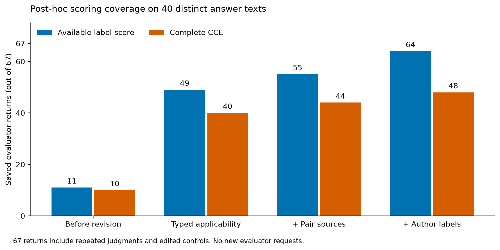
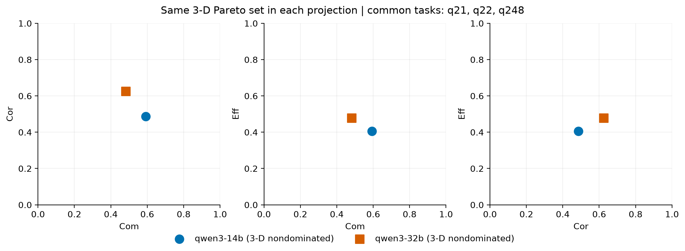

# 标签适用性修复、原文分解与 CCE 实际回放

2026-10-12。本轮按用户确认的 MAP2/荧光团分工、原生 GFP、AF 家族近似及 LLM/EGES 职责继续执行。

**已有真实改善：** 同一批 67 份存档评价返回中，标签分可计算数从 11 增至 64，完整单值 CCE 从 10 增至 48。另有 3 份答案得到 6 组完整条件 CCE。新增本地/API 模型请求为 0，新增专家记录为 0。67 份返回对应 40 个不同答案全文，包含重复评价和受控编辑，不能写成 67 个独立自然答案。

逐答案最终表：[per_answer.csv](with_time_branches/per_answer.csv)；完整来源与推导：[results.json](with_time_branches/results.json)；实际执行命令：[commands.md](commands.md)。

**实验目的与分阶段结果**

这轮检验的问题是：标签角色、通道适用性、知识检索和关系提取分别造成了多少缺分。固定答案、旧直接判分和原始 SR/SP，逐层加入修订后回放。因此它能说明工程及语义修复的覆盖影响，不能单独证明新评价器的科学准确性、独立稳定性或泛化性能。

| 处理条件 | 标签分可计算 | 完整单值 CCE | 证据与含义 |
|---|---:|---:|---|
| 本轮前的来源范围＋时间中点版本 | 11/67 | 10/67 | 沿用此前两份作者分解 |
| 标签类型、适用通道、AF 家族一致证据 | 49/67 | 40/67 | 大量缺分来自把不适用通道当成必需缺值 |
| 再加入有来源的靶标–荧光团关系 | 55/67 | 44/67 | 填补通用配对知识，保留具体方法的染料数值 |
| 再加入 13 个答案的作者来源标签核对 | 64/67 | 48/67 | 保存关系、原文位置与仍存在的歧义 |
| 再拆解三个时长复杂答案 | 64/67 | 48/67，另有 6 组条件向量 | 时间单值可用数 61→62；可选分支仍分开 |

最后一层作者核对不属于专家回传，也不冒称自动抽取已成功。原先完整的 10 份均保留完整状态，其中 A01 的一份 Codex 返回因错误的 DAPI 靶标通道被修正，S_label 从 0 变为 4.2；其余 9 份原完整向量不变。因此不能写“所有旧完整分数均未改变”。

**具体改了什么，以及没有把什么改成满分**

`MAP2 + Alexa Fluor 488` 在原 marker_dict 粒度下表达 AF488→MAP2：MAP2 是靶标，anti-MAP2 是抗体，AF488 是荧光团。原文已明确这层关系时，不再要求克隆号或完整抗体链才能计算标签分。

原生 GFP/EGFP/tdTomato 和直接染料 DAPI/DiI，不需要外部抗体靶标。其不适用的抗体配对通道保留“not applicable”及理由，方法–荧光兼容性仍调用原函数。例如 GFP 在 FDISCO 下的原方法兼容系数为 0.9，得到 5.4；DAPI 为 0.7，得到 4.2。这里没有把空 marker 编造成生物学靶标，也没有把不适用通道填成 0 或 6。原生 GFP 的存在本身不保证覆盖题目要求的所有细胞和结构，这仍是独立的任务要求问题。

AF 近似采用所选组织范围内已有 AF 系列证据的一致值，不能取其中最高值；明确的特异负证据或冲突不会被覆盖。方法–荧光兼容系数继续按具体染料读取，AF546、AF594、AF647 不因此变成同一数值。

两条新增直接配对证据为 [Thermo Fisher anti-GFP–AF488 A-21311](https://www.thermofisher.com/antibody/product/A-21311.html?CID=AFLBC-A-21311)（另有 [Abcam ab225314](https://www.abcam.com/en-us/products/primary-antibodies/alexa-fluor-488-gfp-antibody-epr14104-gfp-booster-ab225314)）和 [Abcam anti-MAP2–AF594 ab302832](https://www.abcam.com/en-us/products/primary-antibodies/alexa-fluor-594-map2-antibody-epr19691-neuronal-marker-ab302832)。这些来源支持通用配对可行性，不等于验证候选方案的厚组织穿透或透明后信号保持。来源、适用层次和查询路径保存在 [policy_with_sources.json](policy_with_sources.json) 与逐条结果中。

原 SR/SP、c_param、四项旧 Cor 判分及权重保持；原 EGES 每通道数值函数、四项聚合、IA/HV 公式继续复用。通道适用性、证据查询和作者来源解释是本轮明确记录的修订，不能说整个评分定义毫无变化。FPC08 的 Phalloidin 靶标在原匹配函数下得到 0，修复后仍保留该已知零值，并记录来源；没有把所有低分消除。

**实例一：原生信号与核染料，完整走过来源—分解—数值—联合分数**

A01 原文标题给出 `GFP (内源), DAPI / Hoechst / PI`，实际操作明确执行 DAPI。作者分解保留 GFP 和 DAPI，记录 Hoechst/PI 为标题备选，不按最高兼容分挑染料。每条记录带 answer SHA256 和原文字符位置。

原方法函数给 GFP 5.4、DAPI 4.2，适用通道的最小值为 S_label=4.2。原 SR=0.714286、SP=0.750000，c_param=3，所以 Com=0.885714。旧直接判分得 Cor=0.666667。原 EGES 聚合得到 Eff=0.899554，随后 IA=0.666667、HV=0.531165。原先的障碍是标签通道适用性，另有一次返回把 PI 的位置引用错了；重新分解可恢复这部分输入，不能据此称旧模型那次提取已经正确。

**实例二：两种抗体、两种染料，配对含糊但分数可确定**

A04 写了 anti-GFP、anti-MAP2 以及 AF488、AF647，却没有明确谁与谁配对。按原文“不同 Alexa 通道”的描述，枚举 GFP–488/MAP2–647 与 GFP–647/MAP2–488 两种配对。两者得到相同 S_label=4.5，于是可发布这个确定的分数，同时保留配对歧义。结果为 Com=0.885714、Cor=0.875000、Eff=0.515463、IA=0.515463、HV=0.399484。

这提供一种可复用的处理原则：当所有原文允许的解释都给出同一结果时，指标可以确定；不必先伪造唯一配对，也不应取最高分。完整枚举和每种解释的通道值见 [with_author_labels/results.json](with_author_labels/results.json)。

**实例三：区间可取中点，可选路线仍分别计算**

FPC04 的核心步骤合计为 20.5–22.75 h。按已确认的区间中点约定取 21.625 h，S_time=1.1088×10⁻³¹，这是原函数计算出的极小正数，没有人为清零。原文的 AF546 或 AF647 是两个离散标签选择，分别得到 S_label=4.8、5.1，Eff=0.527963、0.540463，因此保留两组完整条件 CCE。

FPC02 的可选漂白形成 22 h 与 34 h 两个分支，S_time 分别为 2.886463 与 3.000000，Eff 分别为 0.768843 与 0.778304。FPC05 的两种过渡洗涤安排形成 87–147 h 与 96–156 h 核心区间，各自中点为 117 h、126 h，Eff 分别为 0.873610 与 0.800272。这三份的全部 6 组结果见 [conditional_CCE.csv](with_time_branches/conditional_CCE.csv)，完整计入/排除清单见 [time_annotations.json](with_time_branches/time_annotations.json)。它们是来源条件下的结果，不是置信区间或六个新样本。

**受控验证：可计算配对增多，但反常现象仍保留**

使用此前真实请求得到的 21 个编辑后全文返回，重放 15 个既有配对。每对基线和变体使用同一修订配置，各自绑定独立全文及已有提取；新增关系注释也绑定各变体自身原文。本轮没有重发端到端模型请求，所以不称为新 prompt 的 E2 验证。[逐对数据](controlled_pairs.csv)。

| 条件 | 完整 CCE 配对 | 实际观察 | 尚需解决的问题 |
|---|---:|---|---|
| 必要模块删除 | 3/3 | 三题 c_param 均降 1；q2 SR 降 0.142857，q21/q22 SR 不变 | 步骤语义匹配存在漏检；SP 可随删除而升高，不能解释成正确性改善 |
| 必要时长删除 | 0/3；c_param 比较 3/3 | 三题 c_param 均降 2；时间输入真实缺失 | 时间 NA 是对照设计的预期结果，不能从基线补回 |
| 等义编号 | 3/3 | SR/SP、Cor、Eff 均不变；q2 c_param 降 1，其 HV 降 0.166172 | 旧判分仍有格式敏感性；另两题全部指标不变 |
| 有依据的顺序冲突 | 3/3 | 三题 Cor 均降 0.25；Eff 不变 | 支持该小样本对顺序冲突的响应，仍非专家验证 |
| 相邻步骤合并诊断 | 3/3 | q21 SR 降 0.714286，q22 升 0.285714 | 原 SR/SP 对切分粒度敏感，数值按原样保留 |

因此，“标签修复有效”和“全部受控条件通过”是两个结论。本轮支持前者，后者尚未成立。下一轮应继续检验编号不变性及步骤切分敏感性，不通过改写分数消除反常。

**稳定性：改善的是可比较覆盖**

在相同的历史 Qwen 重复返回上，按 5 个答案×14 个直接或派生指标统计，70 个重复组中所有返回均有数值的组数从 54 增至 70；这些组的极差均为 0。Codex 相应为 39→49，仍有 21 个指标组含缺值。一个“指标组”指同一答案、同一评价器家族、同一个指标的实际重复值，不等于一个自然任务。每组实际返回数保存在 [archived_repeat_sensitivity.csv](archived_repeat_sensitivity.csv)，取消的一个位置没有被当成成功重复。

这里不是“模型自身波动从很大降为零”：原可比较组本来就是零极差。本轮修复了更多组的缺值传播；作者注释又是共同的确定性输入，不能用它证明模型抽取更稳定。旧 Cor 缺项仍在；新定性 prompt 尚未产生重复评价。

**联合结果、帕累托与重采样**

沿用事前固定的两生成模型、五题、10 个答案；不按新分数换模型或挑答案。两模型是 Qwen3-14B 与 Qwen3-32B，生成器身份单独记录；后续评价器仍按要求优先采用 Qwen3.8。此子集完整数值 CCE 从本轮基线的 4/10 增至 8/10；共同题集 Q* 从 {q22} 扩展为 {q21,q22,q248}。q1 和 q2 的另一模型仍有真实标签缺口，未放入均值。

| 生成模型 | 平均 Com | 平均 Cor | 平均 Eff | 平均逐题 IA | 平均逐题 HV |
|---|---:|---:|---:|---:|---:|
| Qwen3-14B | 0.592593 | 0.486111 | 0.406228 | 0.393941 | 0.122909 |
| Qwen3-32B | 0.481481 | 0.625000 | 0.478403 | 0.395996 | 0.138257 |

14B 的完整性较高，32B 的正确性和有效性较高，两者均为三维非支配解。IA/HV 是先逐题计算再平均，不是用三维均值重新求 min 或乘积。结果仅描述这个已开发暴露的小子集。[逐题与均值](joint/summary.json)。

同步任务重采样沿用 2,000 次和固定种子，同时完整枚举 3³=27 种有放回抽样。两种计算下，两模型的非支配入选频率均为 100%。这是三个现有任务的重采样描述，不是新增 2,000 次模型评价，也不是泛化保证。原答案 SR/SP 在每次抽样中始终不变。[重采样与精确枚举](joint/task_bootstrap.json)。

来源家族重采样仍待定，因为同题的两个实际路线有不同的来源家族；不能凭空赋成同一个家族。保守来源重叠分析另存 [source_overlap.json](joint/source_overlap.json)，本轮不以独立任务 bootstrap 冒充来源家族 bootstrap。

**Correctness 候选已实现，旧缺分尚未被重新判定**

已实现 [新的 prompt 生成入口](../../../ClearEval-public/scripts/cce_qualitative_correctness_candidate_v1.py)，生成 5 份现有开发答案的完整输入、schema 和逐行差异：[待运行清单](qualitative_prompt_pending/manifest.json)。候选保留 co_order/co_method/co_param/co_chem 的 3/2/2/1 量表与等权聚合，移除 co_param 的“时间/浓度偏差 50%”数值落档，改为结构、逻辑、方法试剂一致性和常识性物理/化学错误审查。数值适配由 EGES 计算。每个直接分项仍须给出原文依据、适用判据和落档理由。

这包含 co_param 判据的实质变更，必须作为新版本测试。不能将旧的 11 个 Cor null 自动改成 2，也不能沿用旧分数宣称新 prompt 已通过。原 prompt、原返回和对照分数保留。当前批准的本地/API 调用额度为 438/438，本轮没有增加调用；这 5 份只准备完成，尚未请求、尚无新分数。

**还剩什么，以及问题发生在哪一层**

| 剩余项 | 数量/范围 | 所在阶段 | 下一项实际需要 |
|---|---|---|---|
| 旧 Cor 无值 | 11 份 | 原始 LLM 返回已有 null | 用新定性判据重新评价，保留新旧配对；不能靠 JSON 修复补分 |
| 主动删除时长 | E2_03/07/11 | 答案内容本身缺少输入 | 保留预期 NA，使用可判分项比较 |
| 可选时间路线 | FPC02、FPC05 | 原文未唯一选定分支 | 已交付条件 CCE；单值须另有预先固定的分支选择约定 |
| 可选染料 | FPC04 | 原文 AF546/647 二选一 | 两分支结果已交付；不选最高者 |
| 靶标身份矛盾 | FPC09 | 原文标题及抗体步骤均写 c-Fos (Npas4) | 保留身份问题，不能把两者当同义词 |
| 标记关系及方法兼容数据 | FPC11 | 两靶标共享未明确配对的 AF647；NeuroTrace 530/615 缺少对应方法数值 | 补充有适用范围的证据，保留当前其他可判分项 |
| 编号与步骤合并敏感性 | 上述 E2 反常对 | 旧直接评分及步骤表示 | 下一版同配置完整配对验证 |
| 专家与独立确认 | 一位专家 5开发＋15留出；本轮无回传 | 科学核验与泛化 | 保持同一个审阅包；本轮作者解释不能替代专家 |
| 来源家族重采样、湿实验 | 家族映射有冲突；无实测数据 | 统计依赖和实验数据 | 分别保留待定，不能用任务重采样或模拟数据代替 |

c-Fos 对应 FOS，NPAS4 是另一个基因；见 [NCBI FOS](https://www.ncbi.nlm.nih.gov/gene/2353) 与 [NCBI NPAS4](https://www.ncbi.nlm.nih.gov/gene/266743)。因此 FPC09 的问题有实际身份依据，不是仅因缺少括号解析规则而保留 NA。

**核验和论文表述**

18 组针对性实现检查通过，涵盖 67 份返回的 804 个应保持不变的值、原文件哈希、来源位置、明确负证据优先、AF 冲突、不适用通道、已有零值、条件分支和 15 对编辑全文身份。时长计算另检查全部 6 组条件向量与删除对照；联合分析核对固定队列、原 SR/SP、同步抽样和精确枚举均值。图已检查文字与裁切，保存 PNG/PDF/SVG 和逐图数据。检查数量不是科学样本量。[核验记录](verification.json)。

可用于论文的中文结果表述：在包含重复评价与受控变体的 67 份存档返回上，分类型处理标签通道适用性并补充有来源的配对知识，将完整数值 CCE 覆盖由 10/67 提高到 44/67；加入作者来源核对后达到 48/67。固定两生成模型五题子集的共同完整题集由 1 题扩展为 3 题，显示完整性与正确性/有效性的取舍。该回放保留旧直接判断与原始 SR/SP，仍存在表示敏感性、身份/知识缺口及待重新评价的 Correctness 缺值。

English results draft: On 67 archived evaluator returns covering 40 distinct answer texts, typed label applicability increased complete numerical CCE coverage from 10 to 40 returns. Source-supported target–fluorophore relations increased coverage to 44, and source-bound author annotations increased it to 48. In the fixed two-generator, five-task subset, the common complete task set expanded from one to three tasks; both generators remained nondominated. These post-hoc analyses reused the original SR/SP and stored direct judgments. They assess scoring coverage and sensitivity rather than independent evaluator accuracy, and representation sensitivity and unresolved source inputs remained.
