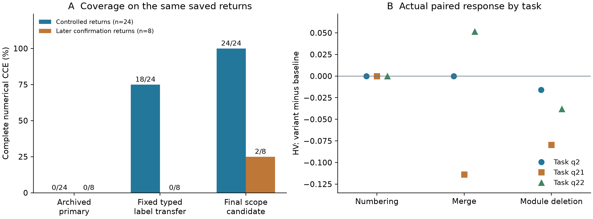

# ClearEval 后续 32 份真实返回：评分覆盖、受控响应与缺分定位

2026-10-12。已完成真实存档的统一离线复算，新增模型调用为 0。

**本轮新增结果**

在既有 24 份受控返回中，完整数值 CCE 从 0/24 增至 24/24；形成 18 个完整成对观测，来自 3 道题、3 类变体、每条件 2 次既有真实请求。在另外 8 份原确认返回中，结构转换从 5/8 增至 7/8，完整数值 CCE 从 0/8 增至 2/8。这里的“完整”指 Com、Cor、Eff、IA、HV 均有有限数值，并采用明确声明的“已报告核心操作”时间范围，不表示方案在科学上完整或正确。

这 32 份返回对应 20 个不同提交全文、14 个规范化全文。本批与上一批 67 份的材料有重叠，不能将返回数相加当作独立答案数。上一批 48/67 的结果保留不动。本轮先固定已有标签规则做迁移，再单独记录根据本批问题提出的时间与边界候选；不能把后者叫作新的前瞻确认。

| 处理条件 | 受控完整 CCE | 原确认批完整 CCE | 本条件实际做了什么 |
|---|---:|---:|---|
| 原存档主处理器 | 0/24 | 0/8 | 保留原返回与原 NA |
| 固定类型标签规则迁移 | 18/24 | 0/8 | 同一份分解重新判断通道适用性、关系和查表；无逐答案新注释 |
| 已报告操作范围、重复通道引用 | 24/24 | 1/8 | 计算已写出的核心操作；依据明确标题判断染色准备；解析已有唯一通道的重复提及 |
| 浓度范围与中文邻接边界 | 24/24 | 1/8 | 两份原部分返回完成结构转换；尚未消除后续语义缺项 |
| 标题层级与常规染色后清洗 | 24/24 | 2/8 | 消除标题被误报为漏操作；按原时间规则排除常规清洗 |

[最终逐答案 CSV](time_heading_candidate_01/per_answer.csv) · [含每阶段值及来源的 JSON](time_heading_candidate_01/results.json) · [实际命令](commands.md)。这些修复没有改变原始 SR/SP、参数完整性和四项 Correctness 判断，也没有改变 EGES 的数值公式。真实未知没有清零；q21、q22 删除变体的极小正时间分分别保留为约 1.11×10⁻¹⁹⁵ 和 5.79×10⁻²²。

图左展示同批返回的覆盖变化，不是准确率。图右每个点是一道题的实际成对差值，两次存档重复得到相同结果；不是六个独立任务。图另存 [PDF](figures/coverage_and_paired_HV.pdf)、[SVG](figures/coverage_and_paired_HV.svg) 和 [逐点数据](figures/paired_HV_plot_data.csv)。

**研究问题与排查过程**

本轮的问题是：上一轮标签修复能否迁移到后续真实返回，哪些 NA 来自程序处理，哪些来自原答案或模型的语义判断？依据行为测试思想，将“格式变化应保持不变”和“删除必要模块应影响对应判项”分开检验；这一设计可参照 [CheckList，ACL 2020](https://aclanthology.org/2020.acl-main.442/)。该文支持测试方式，不证明本项目的生物学判断正确。

排查按“明确现象—查证定义与实现—提出修订—实际复算及反例检查”执行：

| 现象 | 可定位证据 | 原因及本轮处理 | 实际结果 |
|---|---|---|---|
| 删除 RI/保存模块后，剩余步骤有时间但 s_time 为 NA | 三题均有 `time_operations=complete`、`core_time_operations=partial`；理由写的是方案没有这些模块 | 方案缺项与已报告操作的提取完整性被混用。仅计算已报告小计，完整实验终点耗时仍未知 | 6 份删除返回恢复时间；不为被删除的操作补值 |
| q22 删除变体重复提到 Alexa Fluor 二抗，却被认作另一个无靶标通道 | 同文已有明确 MAP2–Alexa Fluor 关系，唯一已用靶标是 MAP2 | 在原有唯一通道与同名染料均有来源时，解析重复引用；多靶标、不同染料及真实冲突不合并 | 两次返回均得到 s_label=4.5 |
| R3C06 的准备阶段已由来源标题明确，时间仍被阻断 | 封闭、透化、抗体及相应洗涤位于明确标记阶段；核心贡献为 72+48+24 h | “可能具有其他作用”被普遍用作否定来源范围的理由。候选使用已标明阶段，不推测未写出的双重作用 | 核心 144 h，完整 CCE |
| `TO-PRO-3 1–2 µM` 和“置于BABB”无法绑定名称 | 两个字符串都在指定原文单元中精确存在 | 前者未识别带单位的浓度范围；后者将汉字与拉丁名称当成一个词。只修正这两类边界，保留已成功的旧引用位置 | R3C04、R3C07 完成转换；原有数值全部保留 |
| R3C08 有完整操作账本，却被标为漏提取 | 未覆盖的五条候选实际上是 `Dehydration`、`Wash` 等标题；标题下操作均已有记录 | 章节标题被误当成额外操作。另有 7 次抗体后的常规清洗误计核心时间 | 74−7×6=32 h；完整 CCE |

Python 的 Unicode 正则将汉字和拉丁字母都纳入默认 `\w`，不能直接用这种字符边界判断生化名称是否被截断；其定义见 [Python 正则文档](https://docs.python.org/3/library/re.html)。本轮仅将这一事实用于文字定位，不用它推断分子身份或兼容性。

时间范围的依据来自仓库原 prompt 第 3.2 项：核心透明时间排除抗体孵育、染色和常规 PBS 清洗，保留透明化试剂转换中的清洗。因此 R3C08 的修订是落实原有定义，而不是为了让时间分更高。R3C02 同样发现了 144 h 的染色后清洗混入候选账本；修订后的初始核心小计为 34.5 h，但其可选核染分支还要求重复透明操作，分支时长未完整展开，单值时间仍保留 NA。

名称转换还发现了另一类问题：R3C01 返回的是 `c-Fos`，引用单元里实际写的是 `C-FoS`。本轮没有把大小写不一致与“字符串存在但边界识别错误”混为一类，也没有借此随意更换引文。[原始失败定位](conversion_diagnosis.json) 保留三份的逐条证据。

**受控验证：现在能够完整比较，仍有两个判项问题**

沿用已有全文规范化实验：q2、q21、q22，各含基线、编号变体、步骤合并变体、必要模块删除变体，每个全文已有两次真实 Qwen 返回。编辑后的全文曾实际重新解析、提取与评分；本轮复用这些返回，在相同候选配置下重算基线与变体。没有把原基线分数复制给变体。

| 条件 | 完整成对观测 | 五项直接判断相同 | 四项 EGES 相同 | 主要发现 |
|---|---:|---:|---:|---|
| 编号变化 | 6/6 | 6/6 | 6/6 | 原 SR/SP 和全部派生 CCE 也完全相同 |
| 合并相邻步骤 | 6/6 | 6/6 | 6/6 | 三题的原 SP 都改变；两题 SR、Com、HV 改变 |
| 删除必要模块 | 6/6 | 0/6 | 2/6 | 三题 HV 均下降；不能据此称所有单项都正确响应 |

编号不变性已有后续真实验证。因此上一份报告所说“编号尚未解决”需要限定为旧历史设置；在这个规范化输入设置中已得到支持。规范化使格式对进入模型的内容一致，这证明的是系统在该设置下的一致性，不是模型对任意原始格式的内在鲁棒性。

删除模块的具体差值如下；每行对应一题，两次返回一致：

| 题目 | ΔSR | ΔCom | ΔCor | ΔHV |
|---|---:|---:|---:|---:|
| q2 | −0.142857 | −0.057143 | +0.041667 | −0.015826 |
| q21 | 0 | −0.200000 | 0 | −0.079636 |
| q22 | 0 | 0 | −0.083333 | −0.038046 |

q2 的 co_order 降 1，但旧 co_param 升 1；两者量表分别为 0–3 和 0–2，等权归一后净效应使 Cor 上升 1/24。这是原始判断和聚合产生的结果，不能靠解析器改成预期方向。q22 的 c_param 与 SR 都没有变化，所以 Com 不变；co_order 的下降仍使 Cor 和 HV 下降。新的定性 Correctness 判据需要真实评价验证，尚不能把这两个问题视为已解决。

合并步骤也仍是独立问题。q21 的 SR 从 5/7 降为 0，Com 从 0.885714 降为 0.6；q22 的 SR 从 5/7 升为 1，Com 从 0.885714 升为 1。原 SR/SP 衡量的是当前切分单位的向量匹配，合并会改变这些单位。按照用户要求，本轮继续展示原值，没有用规范化后的新 SR 替换主值。完整成对表见 [controlled_pairs.csv](scope_candidate_02/controlled_pairs.csv)。

**稳定性与重采样应怎样解释**

24 份存档请求按 12 个提交全文、9 个基础分项构成 108 个“答案×指标”重复组。原先 93 组有两个有限值、15 组均 NA；本轮 108 组均可比较，极差均为 0。若加入 SR/SP 和五个派生指标，共 192 组，亦均为零极差。[逐组值](scope_candidate_02/repeat_groups.csv)。

这表示可比较覆盖提高；原来能比较的组本来就没有波动，不能宣称随机波动被“大幅压低”。本轮没有增加独立重复，没有完成新定性判据的跨评价器稳定性验证。

对成对差值先在每题内合并两次重复，再按三道题同步重采样。保留 2,000 次计算以衔接旧报告，同时完整枚举 3³=27 种有放回抽样，采用相同离散 CDF 分位定义。删除条件平均 ΔHV=−0.044503；精确枚举的 2.5%–97.5% 分位为 [−0.079636, −0.015826]，2,000 次结果相同。合并条件的对应区间跨 0：[−0.113765, 0.051546]。

2,000 不是必要的生物学样本量，也不是模型调用数。在只有三题时，27 种精确枚举更直接。上述范围仅描述这三题的重采样敏感性；来源家族独立性未确立，不能解释为面向所有任务的可靠置信区间。[全部分项重采样结果](scope_candidate_02/paired_task_resampling.json)。

**联合结果、帕累托与合理替代路线**

上一轮固定的 Qwen3-14B/Qwen3-32B 五题比较仍为完整 8/10，共同完整题集 q21、q22、q248；两生成模型均非支配。这一组结果来自另一批已固定输入，本轮没有更换队列或混入新的答案。[旧固定队列的实际联合表](../typed_label_revision/joint/summary.json)。

本批原确认的预定共同支持是 Claude Sonnet 4.6 与 Qwen3-Max 在 q23、q248 上的四份答案。现在 Qwen3-Max 的两份有完整 CCE，但 Claude 两份仍有缺项，因此共同完整题集仍为空。不能用 Qwen 的两份完整答案对比 Claude 的其他题，也不能只看这两个完整值宣称帕累托胜出。后续须补齐同一共同题上的依赖，或继续报告可识别的分项与联合外界。

完整替代路线的科学合理性仍需来源适用性和专家局部核查支持；方法家族内选最大 SR、再最大 SP 的既有规则没有被改动。本轮的编号、合并和删除对照不替代任务包要求的 6–8 个完整替代路线对，也不将高 SR 当作路线有效性的证明。

**五个可逐步核对的真实示例**

每个示例都提供题目、原始完整答案、原始案例与参考、来源文件哈希、逐分项和完整处理链。

| 示例 | 经过的修订与最终结果 | 问题出现的阶段 |
|---|---|---|
| [q2 删除必要模块](examples/R3E2_Q002_necessary_step_deletion__r0/README_zh.md) | 已报告核心 60 h；CCE=(0.685714, 0.833333, 0.949554)，HV=0.542602；基线 HV=0.558428 | 将方案缺项混入时间提取覆盖；旧 Cor 判项响应也有问题 |
| [q21 合并步骤](examples/R3E2_Q021_merge__r0/README_zh.md) | Cor、EGES 不变；原 SR 由 5/7 变为 0，HV 从 0.352673 变为 0.238907 | 原始步骤切分和匹配，不是 JSON 转换 |
| [R3C06](examples/R3C06__r0/README_zh.md) | 72+48+24=144 h；s_label=4.5；CCE=(0.6, 0.666667, 0.612076)，IA=0.6，HV=0.244831 | 准备阶段适用范围被过度阻断 |
| [R3C08](examples/R3C08__r0/README_zh.md) | 原账本 74 h 中排除 42 h 常规染色后清洗，核心 32 h；CCE=(0.733333, 0.875, 0.662989)，HV=0.425418 | 标题漏提取误报与时间阶段分类 |
| [R3C04](examples/R3C04__r0/README_zh.md) | 浓度范围的名称转换已修复；Com=0.6、Cor=1.0 保留，Eff 仍 NA | 后续“所选”中文标题未被方法选择规则识别，标签原始 usage 又均为 mentioned；还存在时间分支/引用缺项 |

最后一例的 Cor=1.0 是旧评价器的实际值，不代表本轮认可科学上满分。结构成功和评价有效性必须分开报告。

**剩余六份为何仍没有完整 CCE**

| 答案 | 当前缺项与证据 | 下一步可检验方向 |
|---|---|---|
| R3C01 | `c-Fos` 与指定单元的 `C-FoS` 不一致；部分时间记录仍未充分绑定 | 源词形与模型规范名分别存储，核查引用定位；不用全局忽略大小写掩盖实体差别 |
| R3C02 | 可选核染分支要求再次脱水/透明，回指及额外时间没有完整展开 | 保留初始核心 34.5 h 小计；来源绑定后分别计算分支，不挑最优分支 |
| R3C03 | 原答案确实截断于 `1.1 Incubation with`，缺少操作信息；原始 Cor 也有 null | 按新定性缺项判据再评价可判分项；不能创造时长 |
| R3C04 | 结构转换已恢复；中文选择提示未被接受、已用标签被返回为 mentioned，另有时间缺项 | 验证中文与英文等义选择表达；保留 LLM 判定与程序复核各自的证据，不用严格标题模板代替语义 |
| R3C05 | 标签 E003 关系未决；多条操作的时间/重复绑定不完整 | 对照原文逐记录定位，区分范围、重复回指与真实缺值 |
| R3C07 | 中文邻接转换已恢复；AF647 与 TUJ1/β-III Tubulin 关系仍未正确投影，另有时间冲突/范围 | 对别名与括号词形保留来源对应，分别检验关系与时间范围，不能只靠转换成功宣称完成 |

**下一轮已准备的具体材料**

已将新定性 Correctness 候选接入经过实际验证的完整规范化输入。C0 是原 canonical 判断范围，C1 是用户要求的结构、逻辑、方法试剂一致性及常识性物理/化学审查；C1 移除 co_param 的相对参考数值偏差判档及旧不确定性条款，并明确数值适配交给 EGES。四项 3/2/2/1 量表和聚合保持不变，但 co_param 判据是实质修订，需要新版本验证。

5 份已暴露开发答案各准备 C0/C1 两份请求，共 10 份；两条件的全文、来源映射、参考、schema 和非 prompt 生成参数相同。没有精确相同的现成 C0 返回可作为这组配对基线，因此不能把旧五份直接算作已完成配对。[待运行清单与完整 payload](qualitative_canonical_pending/manifest.json)。25 项材料检查通过，实际请求为 0；这不是独立留出确认，也没有人为预定应得分数。

当前授权账本仍为 438/438。新增请求需要新的计次和时间授权；本轮未绕过原上限。评价器仍采用已存档的本地 Qwen 配置，不使用 Llama 作为评价器。`qwen3.8:27b-q8_0-local` 是本地服务别名，其底层历史元数据记录为 qwen35 家族，不能据此额外声称验证过一个公开发行的 Qwen3.8 型号身份。

**对完整研究目标的逐项审计**

| 原目标 | 当前证据与本轮新增 | 当前结论 |
|---|---|---|
| 来源完整路线、真实逐答案入口、扩至至少两生成模型 | 已有路线选择、固定五题两模型队列；本轮追加 32 返回的统一入口、来源与命令 | 工程交付可复现；不等于全体输入科学核验完成 |
| E1 人评与步骤适配 | 旧评分与量表映射产物保留；新增仍为一位专家、5开发＋15留出共用 | 新专家结果待回传 |
| E2 受控和完整替代路线 | 本轮有 18 完整成对观测；编号一致、删除 HV 下降；合并和局部分项反例保留 | 部分目标得到支持，全部预期效果尚未成立 |
| E3 提取保真 | 本轮定位并修复角色适用性、文字边界、标题与时间范围；逐处来源可核对 | 是作者与程序证据；不是专家确认的准确率 |
| E4 评价稳定性 | 108 个基础分项重复组可比较且零极差，旧跨家族结果保留 | 新判据的真实重复和跨家族验证尚未执行 |
| E5 CCE、IA/HV、帕累托、重采样 | 原固定队列结果保留；本批 18 对和 27 精确/2,000 次任务重采样完成 | 本批确认的共同完整题仍为空；来源依赖问题未据此解决 |
| E6 湿实验 | 既有计划、随机化和数据入口复用 | 无真实测量，不能给出实证结论 |
| 论文图表、解释、示例与恢复 | 本文、逐答案表、可导出图、五个实例、命令已生成 | 本轮交付完成，整体评估器优化目标未完成 |

**核验范围与可用于论文的文字**

已核对 336 个输入/原返回相关文件，受影响和不受影响分项分别检查。阶段范围候选有 73 项检查；文字边界候选有 170 项，包括 32 份真实返回重新转换和多个名称反例；标题/清洗候选有 65 项，包括旧删除时长对照不补值、清洗转换步骤保留、24 个 E2 结果不变。检查次数不是实验样本量。第一个边界回放入口曾因新恢复记录没有传入 `quantitative_data` 中断，已修复并保留 [失败记录及代码快照](lexical_candidate_01/failure.json)；失败没有触发模型重试。

对论文可作如下有限表述：在包含 24 份既有受控评价和 8 份后续确认评价的存档集合上，固定类型标签规则首先恢复了 18 份受控答案的完整数值 CCE。进一步区分已报告操作与完整路线、修正重复通道引用、文字边界和时间阶段解释后，覆盖达到 24/24 与 2/8。编号变化保持所有指标一致，合并步骤仍影响原始 SR/SP；必要模块删除在三道题上均降低 HV，但两道题的局部分项响应仍有缺陷。结果支持更精确地定位处理层缺分，尚不支持通用评价准确率或新判据稳定性的结论。

English results draft: On 32 archived evaluator returns, fixed typed-label rules restored complete numerical CCE scores for 18 of 24 controlled returns. Subsequent source-scope corrections increased coverage to 24/24 controlled returns and 2/8 later confirmation returns. All numbering pairs were invariant, whereas merging steps still changed the original SR/SP. Module deletion reduced HV on all three tested tasks, although component-level anomalies remained. These post-hoc results quantify scoring coverage and behavioral sensitivity; they do not establish independent evaluator accuracy or prospective generalization of the revised rules.
